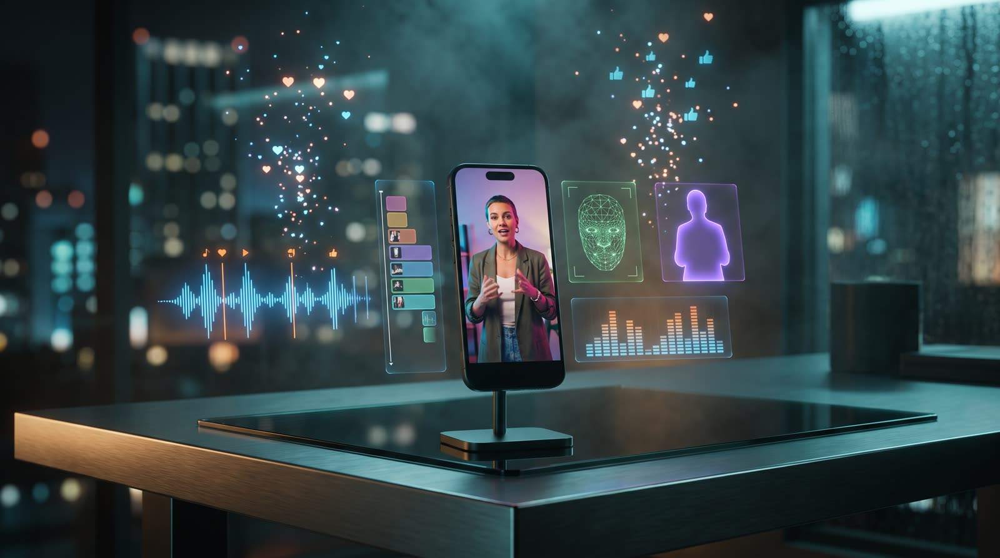
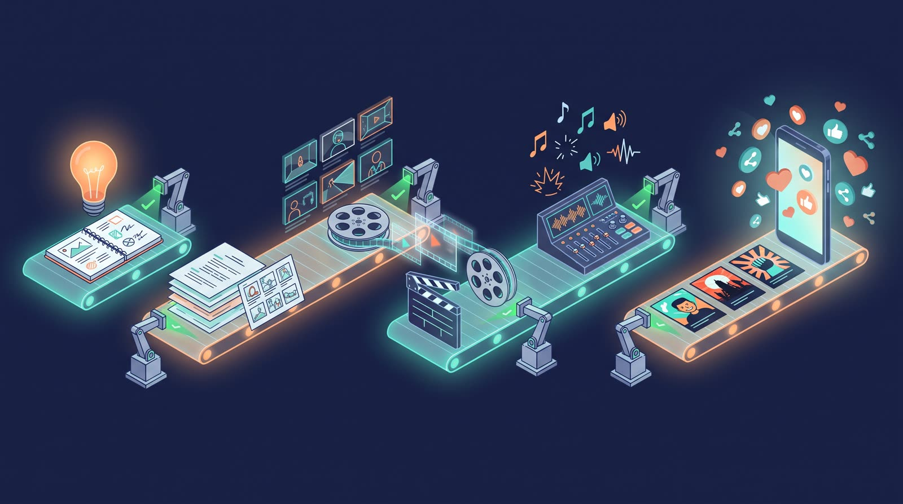
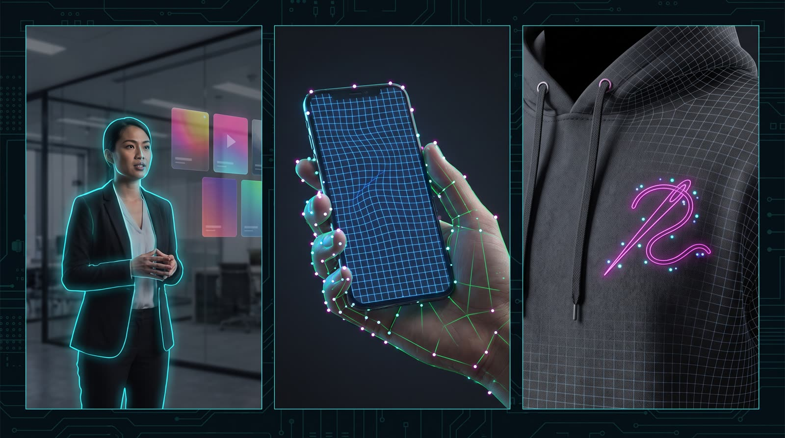
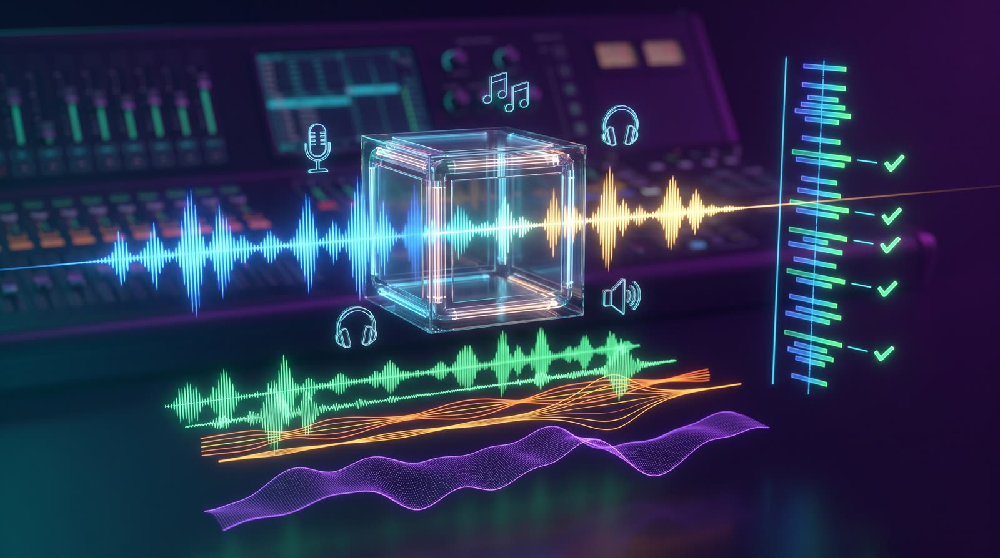
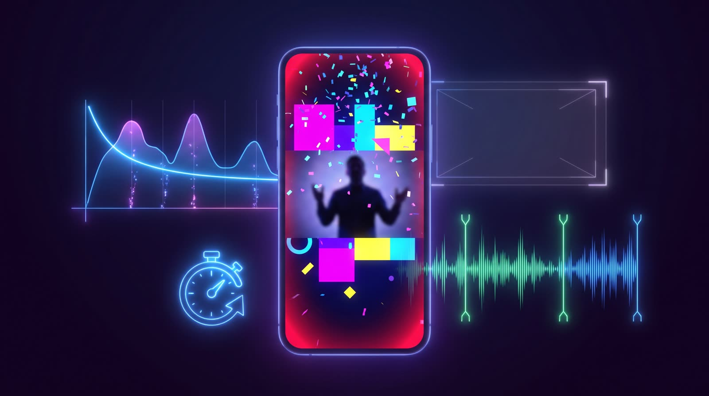

<p align="center">
  
</p>

<h1 align="center">gaspol-video</h1>

<p align="center">
  <b>Not a prompt writer. Not a video editor. A whole AI video studio, run from one chat.</b><br>
  <b>v3.21.1</b> · Claude Code plugin · MIT
</p>

<p align="center">
  Story engine · computer vision · voice and sound AI · coded motion graphics · viral short-form toolkit · self-checking at every step
</p>

---

## In one minute

You bring a product, a service, or a link to a reel. gaspol-video brings the rest:

- a **script** built like a storyteller's, researched for the real place and industry it shows,
- **keyframes and clips** for VEO 3.1, Seedance 2.0 and Kling 3.0, with faces and costumes locked across scenes,
- **computer vision** that tracks screens, cuts the speaker out of the frame and stitches logos onto moving cloth,
- **voice, music and sound effects** generated, cleaned, timed to the words and mixed by measurement,
- **short-form packaging** built on a viral framework: hook timing, kinetic keywords, safe-area layout, retention checks, three thumbnail bets.

Every step checks its own output before you pay for the next one. Every check that could not run says so.

| | |
|---|---|
| **11** skills, **2** agents | the full line from brainstorm to packaging |
| **78** registered tools | Python, Node and ffmpeg, routed by one registry |
| **31** `vidkit` commands | a reusable video assembly library |
| **42** reference documents | the craft knowledge the skills load on demand |
| **1,900+** automated tests | Python, Node and consistency checks guard every rule |

---

## From idea to a finished, mixed video

<p align="center">
  
</p>

| Phase | Skill | What happens |
|---|---|---|
| 1 | `/video-brainstorm` | Language, cast of 1-5 characters, product, **location and domain research** (six location-aware searches), audience, awareness level, video type, tone |
| 2-3.5 | `/video-script` | 7-beat script, scene breakdown, reference manifest. A **hard gate**: no image is made until every reference exists |
| 4 | `/video-image` | Asset library first (faces, costumes, vehicles, products), then one keyframe per clip built from those assets |
| 4.5 | `/video-explainer` | Scenes that must be **readable** are coded in Remotion, timed to the narration |
| 5 | `/video-gen` | The keyframes are looked at, then clip prompts are written for VEO, Seedance or Kling, scene by scene |
| 6 | `/video-post` | Voice, edit, sound effects, captions, music, final mix |
| 7 | `/video-package` | One title, three thumbnail bets on three different levers, one description |
| — | `/video-repackage` | Paste a link to someone else's reel; keep the structure, regenerate everything |
| — | `/video-full` | Runs the whole line with an approval gate between phases |

Work moves in **kelompok**, batches of at most five scenes. Each batch is cut and approved before the next one starts, so a mistake costs five scenes, not fifty.

<p align="center">
  
</p>

---

## Machine learning behind the scenes

<p align="center">
  
</p>

AI video models make beautiful clips and then get the details wrong: the app on the phone, the logo on the shirt, the text over the speaker's face. gaspol-video fixes those details with computer vision instead of hoping for a better render.

### Vision

| Model / method | What it does here |
|---|---|
| **TAPNext++** point tracking (Apache-2.0) | Follows hundreds of points on a phone, monitor or shirt through the clip, even when a hand covers them |
| **SAM 2.1** segmentation (Apache-2.0) | Masks a shirt, a hand or a screen from one click, through every frame |
| **Homography per frame**, RANSAC edge fits, One-Euro smoothing | `vidkit screen-insert` puts your real app screen onto a phone or monitor in a generated clip. Fingers stay in front, motion blur and light are matched |
| **Raised-thread embroidery** | `vidkit embroider` stitches a logo onto clothing that bends with the folds, and never over the hands |
| **MediaPipe** selfie segmentation | A per-frame person matte, so keywords, photos and video panels sit **behind** the speaker |
| **OpenCV YuNet** face detection | The layout gate keeps subtitles, titles and watermarks off the face and inside the platform safe area |

Both tracking tools **refuse** instead of shipping a wrong video: a lost track, a corner that jumps, a screen covered too long. Each refusal has a named fix.

### Voice and sound

<p align="center">
  
</p>

| Model / method | What it does here |
|---|---|
| **ElevenLabs** text-to-speech | One locked voice per character; `[pause: 1.2s]` in the script becomes exact silence |
| **ElevenLabs** speech-to-speech | Swaps the platform's voice for yours on the speaker's turns only, with a fixed `--seed` for repeatable takes; lip sync stays within 0.05 s or it refuses |
| **Guide-voice takes** + prosody picking | An expressive voice reads each line at several settings; the liveliest take is picked by measurement, tightened, then converted to the cast voice |
| **Voice Isolator** and **RNNoise** | Clean platform dialogue before conversion |
| **ElevenLabs Music** and **SFX** | A music bed written for the topic and the story arc, or composed to the finished picture; sound effects from recipes, layered in stacks |
| **Onset and beat detection** | Sound effects snap to the beats of the music; `vidkit audiostudy` measures the sound design of a reference clip |
| **AssemblyAI** speech recognition | Caption timing, and a **second pass on the finished master** that diffs every word against the script (check P6) |
| Two-pass **loudness** normalisation, sidechain ducking | The music sits under the voice by measurement, not by guess |

---

## Built to go viral, and to check that it can

<p align="center">
  
</p>

- **A short-form framework in the script.** Seven viral stages with a pass/fail checklist (`viral_checklist.py`), and a timeline the script must hit: thumbnail 0-1 s, hook 0-3 s, foreshadow 3-6 s, body, call to action in the last seconds.
- **Kinetic keywords, never subtitles.** Six text effects timed from the voice's own words, sticker icons, step counters, a red alarm vignette, a falling burst. The tool refuses text on screen for more than half of the speech.
- **Layout gate for TikTok, Reels and Shorts.** Subtitles, watermark and cover title are measured against the safe area and the face box, with a preview per platform.
- **Retention report** (`retention_gate.py`): static frames, the first spoken word, the foreshadow beat, b-roll that matches what is said, music headroom.
- **Packaging that earns the click.** One locked title, three thumbnail bets on three different levers, a verify-by-looking gate for every thumbnail, and an honesty guardrail: the frame never promises more than the video shows.
- **Repackage a reel.** Share a link; the skill cuts it into scenes, keeps the structure, and regenerates every image, voice and sound as your own. No footage, voice or music from the source is reused.

<p align="center">
  
</p>

---

## A story engine, not a brochure writer

- **The customer is the hero. The product is the bridge.** Nine commandments, 22 rejection signals, and a rule that every pain found in the brainstorm is dramatized, not just the easy one.
- **A 100-hook vault**, call-to-action frameworks per awareness level, audience profiles from the boardroom to the end consumer.
- **Research before writing.** A hospital in Surabaya does not look like one in Ohio: equipment brands, uniforms, signage and plates come from location-aware research, injected into every prompt.
- **Faces, costumes and places stay the same.** Portrait-first rule, uniform references for real institutions, a uniqueness filter so you never pay to generate a generic coffee cup.
- **"Is this physically possible?"** Every image and video prompt answers seven plausibility questions. They come from nine defect classes a client found after the render was paid for.

<p align="center">
  
</p>

## Readable scenes are coded, not generated

No video model renders legible text. Metrics, diagrams, tables and app walkthroughs are built in **Remotion** and timed to the narration. App screens are captured from a real URL with Playwright, or mocked with pinned data for software that does not exist yet, and flagged `simulated` so packaging never sells a mock as a shipped feature.

## It never pretends

- A missing key, binary or network is **named**, with the command that fixes it. The rest of the pipeline continues.
- A check that could not run reports `SKIPPED`, never `PASS`.
- Paid renders are **fingerprinted**: an unchanged prompt, voice line, track or edit stage is reused, not billed again.
- Every number in the tools carries its source: measured, course advice, or marked as interpretation.

<p align="center">
  
</p>

---

## Quick start

```bash
claude plugins marketplace add alisadikinma/ai-content-suite
claude plugins install gaspol-video
```

Then, inside Claude Code:

```
/video-full
```

Answer the questions and approve each phase. Render the clips in-session (NB2 stills, VEO 3.1 fast) or in your platform's own UI when the skill says so.

## Requirements

| What | Needed for | If missing |
|---|---|---|
| Claude Code | everything | — |
| `ffmpeg` / `ffprobe` | assembly, sound, captions, mix | Plans are still written; nothing is rendered, and the skill says so |
| `python3` | most tools (standard library only) | — |
| `node` 20+ and `npx` | voice, Remotion shots, screencasts | Those passes are skipped and named |
| `bash tools/setup.sh` | app-screen capture, face box, person matte, thumbnail post-process, YouTube stats | The tool exits 2 naming the script |
| `bash tools/setup.sh --ml` | TAPNext++ and SAM 2.1 for `screen-insert --mode track` and `embroider` (separate venv, about 2.6 GB of weights) | The tool exits 2 naming the script |
| `ELEVENLABS_API_KEY` in `.env` | voice, voice changing, music, SFX, voice cleanup | Dialogue stays in the platform's own voice; missing recipes are listed |
| `ASSEMBLYAI_API_KEY` in `.env` | caption timing for platform dialogue, check P6 | Those scenes are listed as untimed; P6 reports SKIPPED |

Copy `.env.example` to `.env`. **`.env` is gitignored, and the repo only names variables, never their values.**

## Usage

```
/video-full            # the whole line, with approval gates
/video-brainstorm      # Phase 1
/video-script          # Phase 2-3.5
/video-image           # Phase 4
/video-explainer       # Phase 4.5
/video-gen             # Phase 5
/video-post            # Phase 6 (per kelompok, then --final)
/video-package         # Phase 7
/video-repackage       # remake a reel from a link
/video-validate        # --script / --image / --video / --refs / --post / --layout / --retention / --all
/video-add-platform    # scaffold a new video platform
```

Agents: **`video-engine-agent`** for batch work, **`video-prompt-reviewer`** as an independent validator that has never seen the generation rules, so it cannot explain a violation away.

## Production stack

| Layer | Technology |
|---|---|
| Images | Nano Banana 2 (Gemini 3.1 Flash Image), gpt-image-2 for repackage |
| Video | VEO 3.1 (primary), Seedance 2.0, Kling 3.0, or mixed per scene |
| Vision | TAPNext++, SAM 2.1, MediaPipe, OpenCV YuNet |
| Voice and sound | ElevenLabs TTS, speech-to-speech, Music, SFX, Voice Isolator; RNNoise |
| Speech recognition | AssemblyAI (timing and master verification) |
| Motion graphics | Remotion |
| Assembly and mix | ffmpeg through `vidkit` |

## Project structure

```
skills/              11 skills, one per phase plus orchestrator, repackage, validator, platform scaffold
agents/              video-engine-agent, video-prompt-reviewer
reference/           42 craft documents, loaded per phase (global-promo-config.md is the source of truth)
tools/               registered tools; tools/registry.json routes each task to one tool
  vidkit/            python3 -m tools.vidkit --help
templates/remotion/  shot, caption, overlay and screen templates, workspace scaffolder
media/               SFX recipes, music moods, layout and loudness profiles (sourced)
docs/                tool-routing.md, vidkit.md, debugging.md, evals/ (measured runs behind the rules)
tests/               bash tests/run.sh
```

## Changelog

Every release is in [CHANGELOG.md](CHANGELOG.md). Latest: **v3.21.1**, one tool per job. Screen panels go through `vidkit screen-insert` only, `vidkit smooth-track` is retired, `voice_changer.mjs --seed`, and `vidkit sheet` takes exact timestamps.

## Contributing

1. **Change a setting**: edit `reference/global-promo-config.md` only.
2. **Add a tool**: read `docs/tool-routing.md` first; extend `tools/vidkit/`, register it in `tools/registry.json`, run `python3 tools/registry_build.py render`.
3. **Add a video platform**: run `/video-add-platform`.

## License

[MIT](LICENSE)

## Author

**Ali Sadikin**: [GitHub](https://github.com/alisadikinma)
