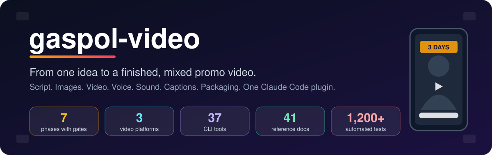
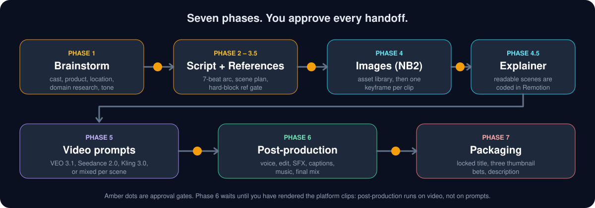
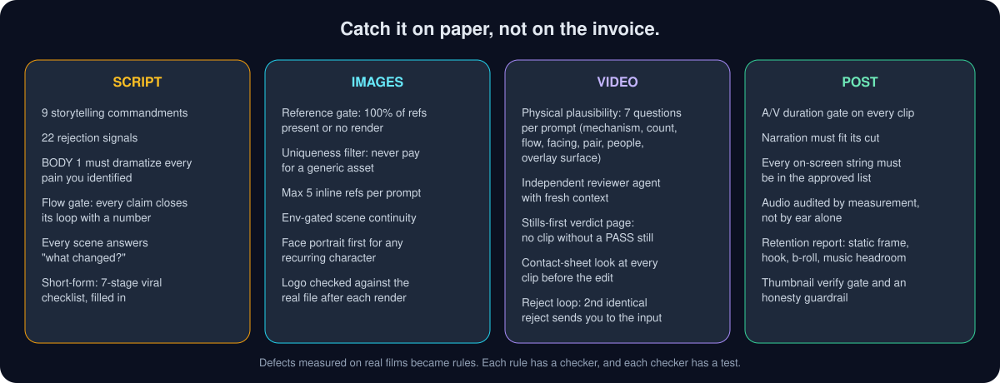
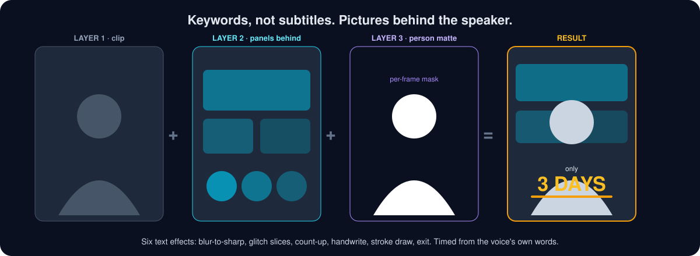
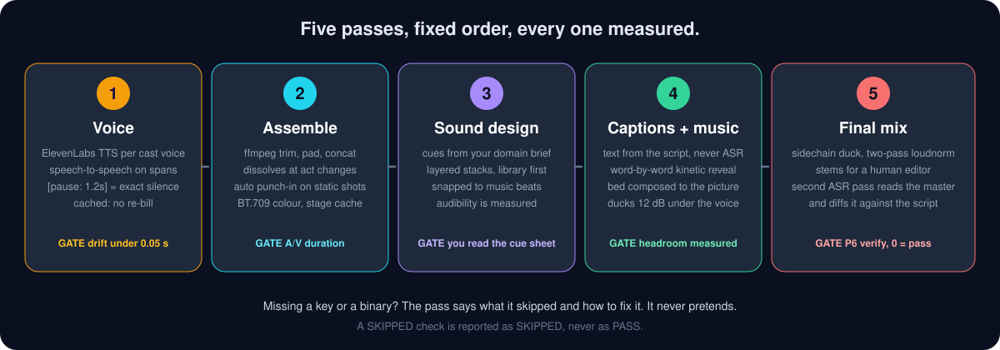
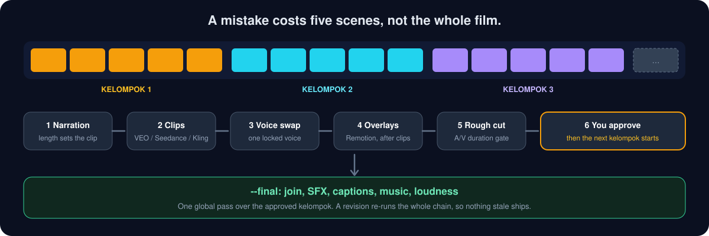
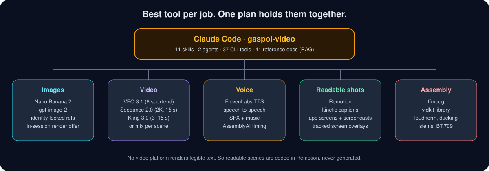

<p align="center">
  
</p>

<p align="center">
  <b>v3.19.0</b> · Claude Code plugin · MIT<br>
  Agencies, freelancers and brand owners: ship a professional 2-3 minute promo from a single chat.
</p>

---

## Why gaspol-video

Most AI video workflows stop at "here is a prompt, good luck". You still write the script, keep faces consistent, fix the voice, time the captions, score the sound and mix the audio by hand.

**gaspol-video runs the whole line.** It takes a product or service and carries it through brainstorm, script, images, video, voice, sound, captions, mix and packaging. It checks its own work at every step, before a credit is spent.

<p align="center">
  
</p>

## What makes it different

### 1. It writes like a storyteller, not a brochure
- **Customer is the hero. Product is the bridge.** Nine hard commandments: never open with the logo, never use jargon without a translation, every feature needs a human consequence.
- A **7-beat arc** (pattern interrupt, hook, foreshadow, agitate, guide, peak, CTA) with a simpler 6-stage alias for people who think in HOOK → BODY → PEAK.
- **22 rejection signals** auto-check every script. BODY 1 must dramatize *every* pain you identified, not just the easy one.
- A **hook vault** of 100 hooks, CTA frameworks per awareness level, and 5 target-market profiles from C-level to end consumer.
- **Domain deep research** before the first line is written: six location-aware searches, so a hospital in Surabaya does not look like one in Ohio.

### 2. Faces, outfits and places stay the same, scene after scene
- **Cast builder** for 1-5 characters with locked identity: face, body and costume references, a portrait-first rule for anyone who appears twice.
- **Institution-aware costumes.** Say "KAI" or "Pelindo" and it asks for the real uniform reference.
- **Asset-first images.** Recurring items become standalone assets, filtered by a uniqueness test so you never pay to generate a generic coffee cup.
- **One keyframe per clip**, a max of 5 inline references per prompt, and scene-to-scene references only when the location really is the same.

### 3. Three video platforms, one plan
- **VEO 3.1**, **Seedance 2.0** and **Kling 3.0**, or mix them scene by scene.
- Each has its own prompt craft built in: camera libraries, lip-sync rules, extension chains, multi-shot storyboards, the "last frame secret".
- **In-session render offers** for NB2 stills and VEO 3.1 fast clips, tracked in a ledger so an unchanged prompt is never billed twice.
- Rules that came from real failures: no real person names in speech lines, no em dash in voice text, no "security camera" (it draws a REC badge).

### 4. It asks "is this physically possible?" before you pay
Every prompt answers seven questions: mechanism, count, flow, facing, pair, people, overlay surface. It catches the fuel filler on the side of a tank, the two gates in one frame, the phone held upside down. These came from nine defect classes measured on a real film, all found by the client after the render was paid for.

<p align="center">
  
</p>

### 5. Readable scenes are coded, not generated
No video model can render legible text. So scenes with numbers, diagrams, tables and UI walkthroughs are **built in Remotion** and timed to the narration. The routing is decided at Phase 3, before any image credit is spent.
- **App screens and screencasts** for software that does not exist yet: capture a real URL with Playwright, or mock one with pinned data shared across every scene. Mock screens are flagged `simulated`, so packaging never claims a mocked flow as a shipped feature.
- **Tracked screen overlays.** Four screen corners are fitted per frame and the panel is attached by homography, so it sticks to a moving laptop.

### 6. Keywords that move, pictures behind the speaker

<p align="center">
  
</p>

- Only the **important** words are highlighted. The tool refuses text on screen for more than half of a scene's speech, so it never turns into subtitles.
- Six text effects, **timed from the voice's own words**.
- Image and video panels, a sliding carousel and photo bubbles sit **behind** the speaker through a per-frame person mask.
- **Kinetic captions** reveal word by word. The text always comes from your script, never from the speech recognizer.
- Title cards that stay off the speaker's face, and **automatic punch-in** on any shot that would hold still for more than five seconds.

### 7. Sound that follows the story
- **Per-character voices** from ElevenLabs. Dialogue spoken by the video platform can be swapped to your locked voice with speech-to-speech, on spans only, so a second speaker is never converted by accident.
- **`[pause: 1.2s]`** in the script renders as exact silence.
- **SFX scored from your domain brief**, with layered stacks, library-first sourcing and cue times snapped to the beats of the music.
- A **music bed composed to the picture**, ducked under the voice, with the headroom measured and not assumed.

<p align="center">
  
</p>

### 8. Delivered in small batches, so a mistake stays small
Work moves in **kelompok**: batches of at most five scenes. Each batch gets its narration, clips, voice swap, overlays and rough cut, and you approve it before the next one starts. Then one final pass joins, scores and masters everything.

<p align="center">
  
</p>

### 9. It never pretends
- Missing key, binary or network? The pass **names what it skipped** and how to fix it.
- A `SKIPPED` check is reported as `SKIPPED`, never `PASS`.
- A **second speech-recognition pass** reads the rendered master and diffs it against your script, so a clipped or invented word shows up before the client sees it.
- A **retention report** and a **7-stage viral checklist** for short-form, with course-derived numbers tagged `source: course`.
- A **thumbnail honesty guardrail**: the frame's promise must stay inside what the video shows.

### 10. Built to be reused
- **`vidkit`**, a reusable assembly library: A/V gates, crossfade joins, loudness, beat detection, karaoke captions, colour match, cover art, one-plan final mixdown.
- **Repackage** (`/video-repackage`): share a link to a reel, and it cuts the video into scenes, keeps the storyline, regenerates every asset, localizes cast and costume, and runs the normal production line. No footage, voice or music from the source is reused.
- **Cheap to re-run.** Voice, music, SFX, images and edit stages are fingerprinted. Unchanged work is reused, not re-billed.
- **1,200+ automated tests** (Python, Node and consistency checks) guard the rules above.

<p align="center">
  
</p>

## Quick start

```bash
claude plugins marketplace add alisadikinma/ai-content-suite
claude plugins install gaspol-video
```

Then, inside Claude Code:

```
/video-full
```

Answer the questions, approve each phase, and render the clips in your platform of choice when it tells you to. See [Installation](#installation) and [Usage](#usage) for details.

---

## What It Does

Give it a product or service, and the engine walks you through Phase 1 to Phase 7:

1. **Brainstorm** — language, cast builder (1-5 characters), institution detection, target market, awareness level, storyline input, tone and mood
2. **Script** — 2-3 minute A/V script on the 7-beat arc, with beat labels, timing, narration and audio direction
3. **Scene Breakdown** — scene count from script beats, video mode per scene, extension strategy
4. **Reference Collection** — auto-derived ref manifest, cultural location research, batch prompts for missing refs, a hard-block gate
5. **Image Prompts (NB2)** — asset library first, then one keyframe per clip composed from those assets
6. **Video Prompts (VEO 3.1 / Seedance 2.0 / Kling 3.0)** — camera, three-layer audio, lip sync, extensions, vocal direction. Phase 5 starts with platform selection, or Mixed for per-scene routing
7. **Explainer Shots (Remotion)** — readable scenes are coded, with every reveal timed to the narration and verified by looking at a still
8. **Post-Production** — voice, assembly, sound design, captions and music, final mix
9. **Packaging** — one locked title, three thumbnail bets on different levers, one value-forward description

Each phase has an approval gate. Phase 3.5 is a hard block: 100% of reference images must exist before image generation. The Phase 6 SFX cue sheet is a second hard gate: nothing is mixed until you have read it.

## Requirements

| What | Needed for | If missing |
|---|---|---|
| Claude Code | everything | — |
| `ffmpeg` / `ffprobe` on PATH | Phase 6 assembly, SFX, captions, music, mix | Plans are still written and printed; nothing is rendered, and the skill says so |
| `node` 20+ | voice-over and voice changing | Those passes are skipped, named, not silently dropped |
| `python3` | most tools (stdlib only, no pip install) | — |
| `bash tools/setup.sh` (builds `~/.gaspol-video/venv`) | app-screen capture/mock, thumbnail post-process, YouTube stats (Pillow, Playwright, google-api-python-client) | The tool exits 2 naming the script; every stdlib-only tool keeps working |
| `ELEVENLABS_API_KEY` in `.env` | voice-over, voice changing, SFX generation, music bed generation, voice cleanup (isolate method) | Dialogue stays in the platform's own voice; every recipe that could not be made is listed with its prompt |
| `ASSEMBLYAI_API_KEY` in `.env` | caption timing for platform-spoken dialogue, and Check P6 (render verification) | Those scenes are listed as untimed; P6 reports SKIPPED, never PASS |
| Node + `npx` | Remotion explainer shots, screencasts, mock app screens | Shot source is still written; rendering is left to you |
| YouTube OAuth client under `~/.gaspol-video/youtube/` | `yt_stats.py` packaging calibration | Calibration has no real view/watch-time data; CTR is always manual regardless |

Copy `.env.example` to `.env` and fill in the values. **`.env` is gitignored and the repo only ever
names variables, never their values** — a voice id identifies one person's cloned voice on one
account, and does not belong in a plugin.

**Nothing degrades silently.** Every tool that cannot do its job says what it could not do and what
to run to fix it, then lets the rest of the pipeline continue.

## Installation

### Via Claude Code Marketplace (Recommended)

```bash
# Step 1: Add marketplace source
claude plugins marketplace add alisadikinma/ai-content-suite

# Step 2: Install plugin
claude plugins install gaspol-video
```

### Manual Installation

Clone into your Claude Code plugins directory:

```bash
# macOS / Linux
git clone https://github.com/alisadikinma/gaspol-video.git \
  ~/.claude/plugins/gaspol-video

# Windows
git clone https://github.com/alisadikinma/gaspol-video.git ^
  %USERPROFILE%\.claude\plugins\gaspol-video
```

Then restart Claude Code. The plugin auto-registers on session start.

## Usage

### Full Pipeline (End-to-End)

```
/video-full
```

Starts the full interactive pipeline. The orchestrator runs all 7 production skills in sequence, asking questions and generating outputs phase-by-phase with approval gates. It stops before Phase 6 until you have actually rendered the platform clips — post-production runs on video, not on prompts.

**Flags:**
- `--full` (default) — full production plan with storyboard notes, NB2 prompts, VEO prompts, audio specs, extension strategy, post-production checklist
- `--quick` — copy-paste ready prompts only (NB2 + VEO per scene, no production plan)
- `--preset ali` — use Ali Sadikin creator preset instead of generic brand profile

### Individual Skills

Run any phase independently:

```
/video-brainstorm      # Phase 1: brainstorm, cast, product, location, domain research
/video-script          # Phase 2-3.5: script, scene breakdown, reference collection
/video-image           # Phase 4: NB2 asset library + scene keyframes
/video-explainer       # Phase 4.5: Remotion shots for scenes that must be readable
/video-gen             # Phase 5: image review + VEO / Seedance / Kling prompts
/video-post            # Phase 6: voice-over, edit, SFX, subtitles, music, final mix
/video-package         # Phase 7: title, thumbnail bets, description
/video-repackage       # Remake someone else's reel as your own version
```

### Utility Skills

```
/video-validate            # Unified validator (--script / --image / --video / --refs / --post / --retention / --all)
/video-add-platform        # Scaffold support for a new AI video platform
```

### Agents

- **`video-engine-agent`** — handles batch or complex promo work, can be dispatched for parallel processing
- **`video-prompt-reviewer`** — independent validator for NB2/VEO prompt batches (auto-spawned during Phase 4B and Phase 5)

## Production Stack

| Component | Technology |
|-----------|------------|
| Image Generation | Nano Banana 2 (NB2) — Gemini 3.1 Flash Image |
| Video Generation (Primary) | VEO 3.1 — 720p/1080p, 8s clips, 148s extension chain |
| Video Generation (Alt) | Seedance 2.0 — native 2K, 15s clips, @ reference system, dual-branch AV |
| Pipeline (VEO) | NB2 image → VEO First+Last Frame / Ingredients → VEO Extend |
| Video Generation (Alt) | Kling 3.0 — per-second duration 3-15s, multi-shot storyboard, omni audio |
| Pipeline (Seedance) | NB2 image → Seedance @Image refs + Omni mode → Seedance @Video extend |
| Readable Shots | Remotion — coded animation for metrics, diagrams, tables, UI |
| Voice | ElevenLabs `eleven_multilingual_v2` (TTS) and `eleven_multilingual_sts_v2` (voice changing) |
| Caption Timing | AssemblyAI. Caption TEXT always comes from the script, never from the recognizer |
| Assembly and Mix | ffmpeg — concat, sidechain duck, loudnorm, burned subtitles |
| Screen-Attached Overlays | `tools/track_screen.py` (four-corner tracking) + CSS `matrix3d` homography in `QuadScreenTracked` |

## Storytelling Philosophy

> Product is NEVER the hero. Product is the BRIDGE. Customer is the hero. Brand is the guide.

The script engine enforces **9 commandments (v2.2.0+)** (no opening with brand name, no jargon without translation, every feature needs a human consequence, **BODY 1 must dramatize ALL identified problems**, etc.) and auto-checks for 22+ structural failure patterns.

## Changelog

Every release is in [CHANGELOG.md](CHANGELOG.md).

## Project Structure

```
.claude-plugin/plugin.json          # Plugin metadata
hooks/                              # Session start hook
skills/                             # 11 skills
  video-brainstorm/                 # Phase 1 — brainstorm, cast, product, location
  video-script/                     # Phase 2-3.5 — script, scene, reference collection
  video-image/                      # Phase 4 — NB2 asset library + scene keyframes
  video-explainer/                  # Phase 4.5 — Remotion shots for readable scenes
  video-gen/                        # Phase 5 — image review + video prompts
  video-post/                       # Phase 6 — VO, edit, SFX, captions+music, mix
  video-package/                    # Phase 7 — title, thumbnail bets, description
  video-full/                       # Orchestrator — runs the production skills in sequence
  video-repackage/                  # Remake someone else's reel as your own version
  video-validate/                   # Unified validator
  video-add-platform/               # Scaffold a new video platform
agents/
  video-engine-agent.md             # Subagent for batch/complex work
  video-prompt-reviewer.md          # Independent prompt quality validator
reference/                          # 41 reference documents (RAG knowledge base)
  global-promo-config.md            # Single source of truth for all settings
  storytelling_script_gen/          # Storytelling and script references
  image-video-gen/                  # Image and video production references
  post-production/                  # Post-production and packaging references
tools/                              # 37 CLI tools: 35 python3 (mostly stdlib) + 2 node, ffmpeg throughout
  vidkit/                           # Reusable assembly library (python3 -m tools.vidkit --help)
  _venv.py, setup.sh                # Dependency guard + venv builder for tools that need libs
templates/remotion/                 # Shot, caption, overlay and screen templates, workspace scaffolder
media/sfx/library/palette.json      # SFX recipes. Clips generated per install, never committed
media/music/library/palette.json    # Music moods mapped to the six tones
docs/img/                           # README illustrations
docs/tool-routing.md                # Task → tool table. Read before writing any script
docs/evals/                         # Measured runs and probes behind the rules
tests/                              # bash tests/run.sh — consistency, python unittest, node --test
CHANGELOG.md                        # Every release, newest first
.env.example                        # Variable NAMES the tools read. Never their values
```

## Configuration

All configurable values live in `reference/global-promo-config.md` — the single source of truth. Settings include default language, video/image resolution, film stock, color temperature, NB2 parameters, VEO duration, output mode, and creator preset.

## Contributing

1. **Change a setting** — edit `reference/global-promo-config.md` only
2. **Add a reference file** — create in `reference/`, update relevant SKILL.md + agent + CLAUDE.md, run `/video-validate --refs`
3. **Add a video platform** — run `/video-add-platform` to scaffold everything

## License

[MIT](LICENSE)

## Author

**Ali Sadikin** — [GitHub](https://github.com/alisadikinma)
